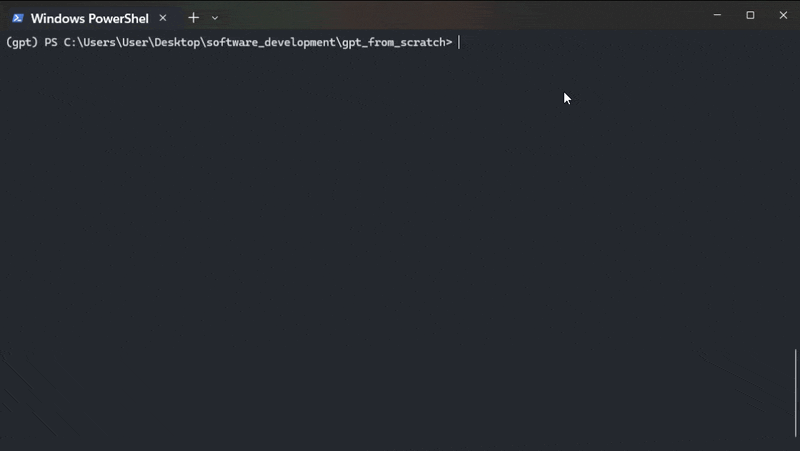

# GPT from Scratch



A character-level GPT built by following Andrej Karpathy's video [**Let's build GPT: from scratch, in code, spelled out**](https://www.youtube.com/watch?v=kCc8FmEb1nY). The code from the video's notebook has been split into separate modules.

The model is a decoder-only Transformer:

```
token embedding + position embedding
  → N × Block (LayerNorm → Multi-Head Causal Self-Attention → residual,
               LayerNorm → FeedForward → residual)
  → LayerNorm → Linear (logits over the vocabulary)
```

By default it trains on `input.txt` (Tiny Shakespeare), predicting the next token at each position. Two tokenizers are available:

- `char` (default): one character = one token.
- `bpe`: byte-level BPE. Starts from 256 bytes and merges frequent pairs into new tokens (vocab size 512).

## Project Structure

| File | Contents |
| --- | --- |
| [config.py](config.py) | Paths, random seed, and all hyperparameters |
| [data.py](data.py) | `CharDataset` and `BPEDataset`: encode/decode, plus a shared train/val split and random batch sampling |
| [tokenizer/tokenizer.py](tokenizer/tokenizer.py) | Learns BPE merges from a text file and writes `tokenizer/encoder.json` |
| [tokenizer/tokenizer.ipynb](tokenizer/tokenizer.ipynb) | Notebook walkthrough of the BPE algorithm |
| [model.py](model.py) | `Head`, `MultiHeadAttention`, `FeedForward`, `Block`, `BigramLanguageModel` (including `generate_stream`, which yields one token at a time, and `generate`, which collects them all) |
| [train.py](train.py) | `estimate_loss` and the training loop; saves `best.pt` whenever validation loss improves |
| [main.py](main.py) | Command-line entry point with `train` and `generate` modes, and a `--tokenizer` option |
| `input.txt` | Training corpus |
| `tokenizer/encoder.json` | The learned BPE merges (used by `BPEDataset`) |
| `best.pt` / `best_bpe.pt` | Best weights (lowest validation loss) for the char / BPE model |
| `more.txt` | Generated output |

## Default Hyperparameters

| Parameter | Value | Parameter | Value |
| --- | --- | --- | --- |
| `batch_size` | 64 | `n_embd` | 384 |
| `block_size` (context length) | 256 | `num_heads` | 6 |
| `max_iters` | 5000 | `num_layers` | 6 |
| `learning_rate` | 3e-4 | `dropout` | 0.2 |
| `eval_interval` / `eval_iters` | 500 / 200 | `generate_tokens` | 10000 |

Edit [config.py](config.py) to change them. The GPU is used automatically when CUDA is available.

## Environment Setup

### Using Conda

```bash
# Create the environment from environment.yml
conda env create -f environment.yml

# Activate the environment
conda activate gpt
```

## Usage

```bash
# Train: evaluates every 500 steps and saves the best weights to best.pt
python main.py train

# Generate: loads best.pt, starts from token 0, produces 10000 characters, writes them to more.txt
# Characters are written and flushed one by one as they are sampled
python main.py generate

# Same, but stream the text to stdout instead of the file (progress info goes to stderr)
python main.py generate --stdout
python main.py generate --stdout > out.txt

# Use the BPE tokenizer instead (weights go to best_bpe.pt)
python main.py train --tokenizer bpe
python main.py generate --tokenizer bpe
```

Weights from different tokenizers are not interchangeable, so use the same `--tokenizer` for `train` and `generate`.

### Retrain the BPE merges (optional)

```bash
python tokenizer/tokenizer.py input.txt   # rewrites tokenizer/encoder.json
```

The first BPE run encodes the whole corpus (slow) and caches the result in `tokenizer/encoder.json.ids.pt`; later runs reuse it.

## Mapping the Video to the Code

- Character-level tokenizer, train/val split, `get_batch` → `data.py`
- BPE tokenizer (from Karpathy's tokenizer lecture) → `tokenizer/tokenizer.py`, `BPEDataset`
- Self-attention (Q/K/V, scaled dot-product, causal mask) → `Head`
- Multi-head attention and projection → `MultiHeadAttention`
- Feed-forward, residual connections, LayerNorm, dropout → `FeedForward` / `Block`
- Full model and autoregressive generation → `BigramLanguageModel` (the name is kept from the video, where the model grows out of a bigram model)

## References

- Andrej Karpathy, [Let's build GPT: from scratch, in code, spelled out](https://www.youtube.com/watch?v=kCc8FmEb1nY)
- Vaswani et al., *Attention Is All You Need*
